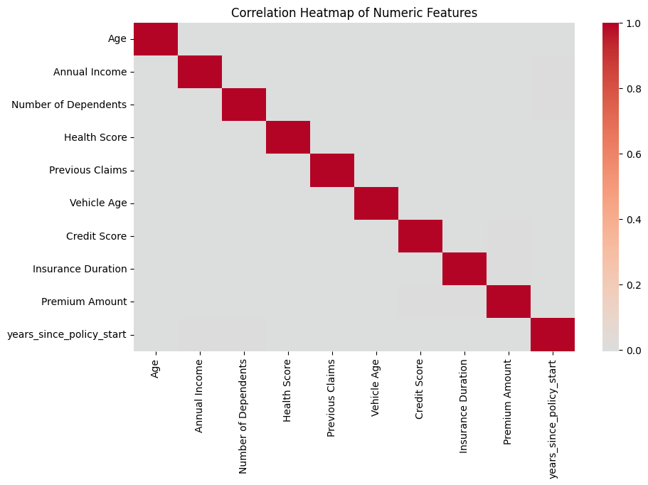
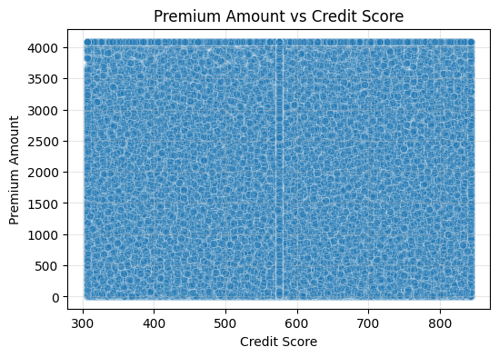

# Insurance Premium Prediction: Proving a Dataset Has No Signal

A 3MTT capstone project. The brief asked for a model that predicts insurance premiums for SecureLife Insurance Co., a fictional company, from 278,860 synthetic policy records.

**The finding:** none of the 18 customer and policy features predicts the premium. Four models, including two tree ensembles, score R² ≈ 0 on 55,404 held-out policies. That means they do no better than quoting every customer the average premium. This repository shows how I tested that, why I trust it, and what data the business would need instead.

## Results

| Model | MAE | RMSE | R² |
|---|---|---|---|
| Ridge Regression | 695.0 | 897.2 | -0.0002 |
| Linear Regression | 695.0 | 897.2 | -0.0002 |
| Gradient Boosting (100 trees) | 695.0 | 897.3 | -0.0003 |
| Random Forest (100 trees) | 719.9 | 908.5 | -0.0255 |
| Ridge, grid-search tuned (alpha 100) | 695.0 | 897.2 | -0.000 |

80/20 split, `random_state=42`. The premium's standard deviation is about 895, so an RMSE of 897 is what a constant guess scores.

## Why I trust the result

| Evidence | What it shows |
|---|---|
|  | The strongest correlation with the premium is Credit Score at **0.005**. Every other feature is closer to zero. |
|  | Premiums are spread evenly from 0 to the cap at every credit score. The same holds for income, health score, previous claims and age. |

- The flexible models (gradient boosting, random forest) found nothing the linear ones missed. The random forest did worse because it fitted noise.
- Grid search pushed Ridge to the strongest regularisation on offer, which is what happens when the best model is close to a constant.

## A correction to my first write-up

My first report ranked Ridge coefficients ("education, exercise and smoking drive premiums"). The largest coefficient is about ±9.5 on a premium that varies by about 895, so those values are noise ([figure](figures/ridge_coefficients.png)). The notebook's final report now says so. The cell that writes `model_insights_and_recommendations.txt` still shows the original wording.

## What the business would need instead
Sum insured, deductible, claim amounts (not just counts), underwriting decisions and, for auto cover, vehicle value or telematics. With that data I'd model a log-transformed premium and compare every model with a predict-the-mean baseline from the start.

## What's here
- `notebooks/insurance_premium_analysis.ipynb`: the full run with outputs. It covers loading and profiling, imputation with missing-value flags, a `years_since_policy_start` feature, a scikit-learn preprocessing pipeline, four models, Ridge tuning and the final report.
- `figures/`: the three charts above.

## Run it
The notebook downloads the dataset from Google Drive with `gdown` (file id in the first code cell).

```bash
pip install pandas numpy scikit-learn matplotlib seaborn joblib gdown
jupyter notebook notebooks/insurance_premium_analysis.ipynb
```

**Skills shown:** data profiling, imputation strategy, scikit-learn pipelines, regression model comparison, hyperparameter tuning, and checking a result before reporting it.
